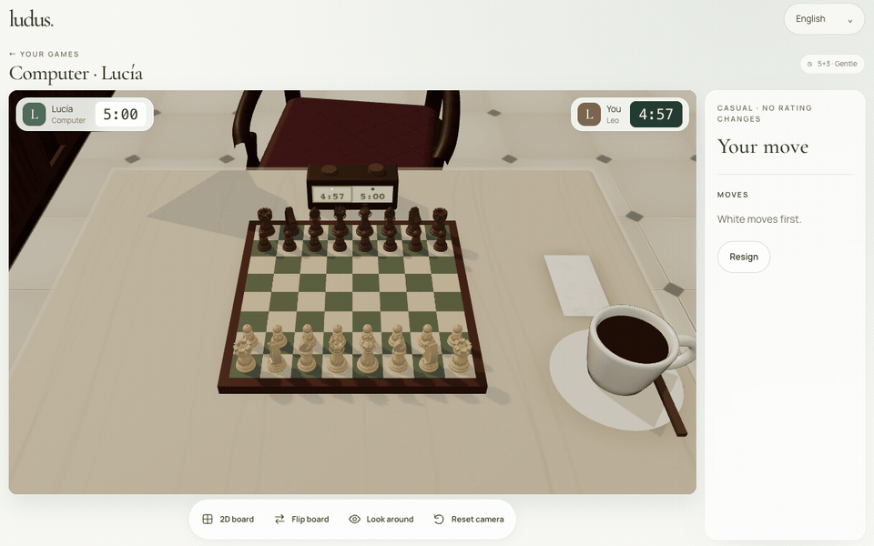

<p align="center">
  
</p>
<h1 align="center">ludus.</h1>
<p align="center"><strong>A café table. A chessboard. Your next move.</strong></p>
<p align="center">
  Play chess in a Madrid-inspired café, with wooden pieces and a board you can turn in your hands.
</p>
<p align="center">
  <a href="https://ludus.mrlemoos.dev">Join the waitlist</a> ·
  <a href="#take-a-seat">Play locally</a> ·
  <a href="#guides">Read the guides</a>
</p>

<p align="center">
  
</p>
<p align="center"><sub>Recorded from the local app. Game access is invitation only.</sub></p>

## Chess, with a sense of place

Sit down across from Lucía, your computer opponent. Choose your colour, pick a difficulty and play among wooden tables and Baroque architecture inspired by central Madrid. Turn the board, look around the café, then return to your next move.

Prefer a flat board? Switch to 2D at any time. Your game, clock and controls carry over.

- Play against Stockfish with four provisional difficulty levels and 5+3 or 10+5 clocks.
- Move with a mouse, touch or keyboard. The 3D view includes an accessible board; the 2D view offers direct square navigation.
- Return to an unfinished game after a reload. The server owns accepted moves, clocks and results.
- Replay completed games and download them as PGN.
- Choose British English, European Spanish or European French.

Ludus is in development. The public site accepts waitlist entries; invited accounts can access the game at [/play](https://ludus.mrlemoos.dev/play). Human multiplayer, ratings, streaks and post-game AI coaching are planned. Real-device mobile performance and final art still need validation.

## Take a seat

Use Node 24 and the pnpm version pinned in `package.json`.

```sh
pnpm install
pnpm seed
pnpm dev
```

Open the local URL printed by Vite, go to `/play` and choose **Sign in as dev**. Pick your pieces, time control and difficulty, then start a game.

The local setup runs the real Worker API, D1 database and match Durable Objects. It needs no Cloudflare login, email delivery or external AI service. Stockfish runs in a browser worker, so keep the tab active during computer games. Local sign-in only works on loopback hosts with explicit local mode enabled.

## Guides

| Guide | What you'll find |
| --- | --- |
| [Development](docs/development.md) | Local accounts, checks, database migrations, keyboard controls and current chess policies. |
| [Deployment and operations](docs/deployment.md) | Cloudflare setup, authentication secrets, invitations, waitlist data and usage limits. |
| [Product plan](docs/specs/ludus.md) | The agreed scope for online play, coaching and the invite-only beta. |
| [The café](docs/cafe-environment.md) | Madrid references, materials, lighting and the room around the board. |

## Built for the browser

TypeScript, React and Vite power the interface. React Three Fiber and Three.js render the café. Cloudflare Workers, D1 and a SQLite-backed Durable Object per match handle the server state. chess.js validates moves, and Stockfish.js supplies the computer opponent.

## Engine and artwork

The café, chess pieces and procedural wood grain are project-authored. Fonts are self-hosted under the SIL Open Font License.

Stockfish.js is GPLv3. Its licence ships with the generated engine assets. See the [engine licence and distribution notes](docs/deployment.md#engine-licence) for source and distribution obligations.
