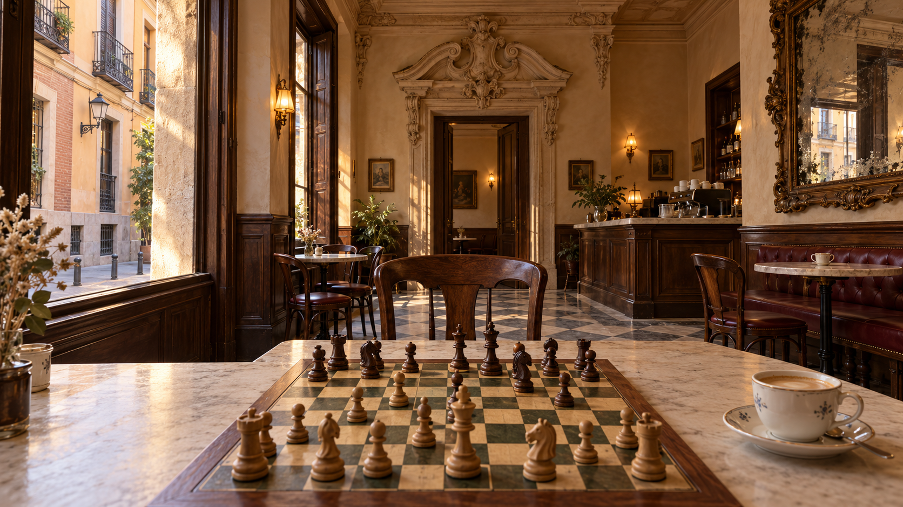

# The Ludus café

Environment art direction, 28 October 2026.

The user has confirmed a Madrid café with Baroque architecture. This replaces the earlier neoclassical direction. The room, layout and treatment below define the production design. A procedural implementation now runs in the game; the acceptance notes below distinguish implementation from remaining validation.



Atmosphere concept generated with the built-in image generation tool. This is not an in-game render or a validated chess position. The lower viewpoint establishes the room; the default play camera must sit higher to make every square readable. Reduce the mirror's heavy weathering in the actual material. The generation prompt is saved in [art/cafe-concept-prompt.md](art/cafe-concept-prompt.md).

## The place

A small café occupies the ground floor of a fictional early eighteenth-century townhouse near Conde Duque. The building is old; the café operates today. An espresso machine, electric sconces and ordinary porcelain belong here alongside carved plaster and worn stone.

You have the table beside the street window. Your coffee is within reach. Across the board is an empty chair, pulled out slightly. Beyond it, a doorway opens into a second room. The bar sits off to the right. Afternoon light catches the wall above the panelling, while the board stays softly lit.

The room should feel familiar after several games. Players can recognise the same uneven floor joint, the same worn patch on the chair arm and the same reflected window in the mirror.

## Architectural references

These are references for particular architectural decisions. The café is an original fictional interior, not a reconstruction of any of these buildings. Reference photography is not automatically licensed for game use.

- [The former Hospicio de San Fernando, Madrid tourism](https://www.esmadrid.com/informacion-turistica/museo-de-historia). Pedro de Ribera's carved portal informs the concentrated ornament around our main doorway. Adapt its scrolls, layered profiles and broken pediment to an interior at domestic scale. Leave broad wall surfaces quieter.
- [San Miguel, the basilica's architectural account](https://basilicadesanmiguel.org/la-basilica/un-patrimonio-artistico-unico/). Its concave and convex architectural forms inform the cornice and doorway profiles. Our room remains small and rectangular.
- [San Antonio de los Alemanes, Madrid tourism](https://www.esmadrid.com/en/tourist-information/church-san-antonio-alemanes). Its painted interior is a reference for an enclosing ceiling. Translate that into a restrained painted ceiling border with an ochre ground and faded botanical scrolls. Keep figurative religious imagery out of the café.

The location, conversion story, furniture, colours and lighting are design choices. The sources establish architectural references, not the existence of this café.

## Room and seat

Use metres for the design. The existing scene uses one unit per chess square. For implementation, use 20 scene units per metre and keep the current board geometry. A square then measures 50 mm and the framed board approximately 433 mm.

| Element | Design dimension or placement |
| --- | --- |
| Main room | 6 m wide, 10 m deep, 4.2 m high |
| Window wall | Left of the default white-side seat; two tall street windows, 0.45 m deep reveals |
| Panelling | Walnut, 1.05 m high, with a continuous chair rail |
| Main doorway | Rear wall, 1.5 m opening, 2.8 m to arch apex, carved surround above |
| Player's table | 1.15 × 0.90 m, top 0.75 m above floor; board centred |
| Playing station | Near the window, with at least 0.65 m between table edge and wall |
| Opponent's chair | Across the board, turned about 8 degrees towards the window |
| Mirror | Right wall, about 1.4 × 2.2 m; lower edge just above panelling |
| Bar | Rear right, 2.4 m long; visible past the opponent's right shoulder |
| Other seating | Two small tables; oxblood banquette along the right wall |

Room geography from the default white-side seat:

```text
                    REAR WALL
        carved doorway        walnut bar
             second room      coffee service

  street    spare table        banquette
  windows                     large mirror
                 opponent
                ┌─────────┐
                │  board  │ coffee
                └─────────┘
                  player
                    FRONT
```

Build the front wall and its entrance too. Turning the board to play Black reveals the other end of the same room. Windows, sunlight, bar and mirror stay fixed in world space. Never rotate the environment with the pieces.

The floor is roughly 15.6 existing scene units below the board surface, accounting for the framed board above the tabletop. The current floor is only 0.8 units below it. Correcting that scale, adding table legs and grounding the chairs are necessary for the feeling of sitting at a table.

## What makes the architecture Baroque

The rear doorway is the principal architectural feature. Two shallow pilasters support a projecting entablature and broken segmental pediment. A small central cartouche joins the split. Acanthus brackets and curling plaster profiles cast real shadows around the opening. Omit heraldic and religious symbols.

The cornice runs continuously around the room, with a deep curved cove and a smaller projecting lip. It must turn actual corners. Repeated freestanding arches floating behind the board cannot establish a room.

Window reveals have thickness, stepped plaster surrounds and stone sills. Dark timber frames and slender iron exterior railings give them a believable scale. The street beyond has a facing façade and pavement, rather than an empty coloured sky.

The mirror is the second ornamental focus. Its frame has softened gilt on raised carving and dark recesses. Most of the wall between doorway, windows and mirror is unadorned lime plaster. The ceiling has one shallow medallion and painted perimeter detailing.

## Materials

| Surface | Treatment | Colour reference |
| --- | --- | --- |
| Walls | Warm lime plaster, broad uneven colour variation, fine surface texture | `#d8c9ad` |
| Carved plaster | Slightly lighter than walls, dirt only in recesses | `#e5d8bd` |
| Panelling and furniture | Dark walnut, grain follows each board, polished contact edges | `#493024` |
| Tabletop | Honed ivory limestone, fine veins, rounded worn edge | `#c8bba3` |
| Floor | Pale limestone with occasional charcoal inserts, diagonal layout | `#b9ad95`, `#4c4942` |
| Banquette | Oxblood leather, shallow creases around cushions | `#592d30` |
| Metal | Aged brass, darkened near fixings | `#987447` |
| Street plaster | Muted ochre and dusty terracotta | `#b08257`, `#925b47` |

Colour values are starting points under neutral light, not final rendered pixels. Wood grain, stone veins and plaster noise need physical scale. Avoid uniform brown materials across the whole scene. Carving reads through profile and shadow before surface noise.

Only the raised mirror carving and a few brass fittings catch bright highlights. The board and pieces remain the sharpest, most legible objects near the player.

## Light and air

Fix the scene at late afternoon in October. Warm sunlight enters the street windows at a low angle and falls on the spare chair, floor and far wall. The table sits just outside the direct beam, lit by a large, soft window source. Both sides of the chess set retain visible grain and silhouette.

Warm 2700 K sconces make small pools of light near the doorway and bar. Daylight remains the main source. Cool reflected street light gives the shadow side of the room some separation from the warm plaster.

Bake indirect architectural light and distant shadows. Use one live shadow-casting window light around the playing station. The coffee, pieces and chair must touch their supporting surfaces through contact shadows. Test the pale pieces against cream squares and the dark pieces against walnut furniture before accepting exposure.

The window view needs brighter values than the room without becoming a flat white rectangle. The mirror must show the opposite window and wall from the correct direction. Use a static room reflection with a roughened surface for the first implementation; camera movement must not expose an obviously sliding photograph. A live planar reflection is only justified if the static treatment fails the camera checks.

## Camera and framing

The existing default camera is high above the board. At its current distance, field of view and downward angle, much of the café is outside the image. Better wall meshes alone will not fix that.

Keep two explicit framings, using the same seat and room:

- The play view opens by default. Start around 44 degrees of downward pitch and a 36-degree vertical field of view, then fit the board to the actual viewport. The whole board and every piece remain visible. Leave a strip of table and recognisable lower-room features around it. Do not promise a full ceiling view from this angle.
- A labelled "Look around" control lowers the camera towards seated eye height, about 1.2 m above the floor. Keep the board in the foreground, with the street window, carved doorway, mirror and cornice visible beyond it. Suspend square selection in this view and show a persistent "Return to board" control. Match clocks continue. Localise both labels.

Play rotation stays constrained to the player's side. Look-around rotation stays within the room and cannot move through furniture or reveal unbuilt scenery. Fit and reset both White and Black views independently. A portrait phone must keep all 64 squares available; it can show less room than a desktop.

Respect reduced motion by switching views immediately. Otherwise use one short, interruptible camera movement. Never sway, bob, orbit automatically or play a compulsory entrance sequence. The existing keyboard board and 2D fallback continue to work.

These framing changes are proposed with the environment design. They require implementation and interaction checks before shipping.

## Signs of use

Place a small café con leche on a saucer near the player's right hand, outside the board's interaction area. A teaspoon rests on the saucer. A folded receipt sits beside it. Keep these objects at believable scale and off square hit targets.

Give the opponent's chair a compressed leather seat and worn arm edges. Keep a folded newspaper on the spare table. Stack cups by the espresso machine. Small chips belong on stone edges, while the middle of the table stays clean.

The first room can feel occupied through these objects and the street beyond. It does not need animated customers. Later sound should be optional and off until enabled: quiet conversation from the second room, a distant cup on a saucer and muffled street traffic. Sound design is not a dependency of the visual build.

## Build order and acceptance

1. Block out the full room, table, chairs, street openings and both camera framings in plain materials. Inspect desktop, portrait mobile, both colours, zoom extremes and camera reset. Confirm that the table and room have human scale before carving anything.
2. Establish window light, exposure, floor contact and the background street. At this stage the window seat must already feel like a place.
3. Add the doorway, continuous cornice, panelling, mirror and ceiling. Use shared meshes for repeated mouldings and furniture. Bake small distant relief into textures; model the silhouettes visible from the seat.
4. Finish wood, stone, leather and the few close props. Keep the board's existing square controls, move markers and piece geometry intact.
5. Measure the room on named iPhone and Android hardware. Aim for at least 30 FPS during board movement. Reduce reflection cost, shadow resolution and distant ornament before reducing board clarity. The current automatic quality reduction and manual 2D view remain available.

Accept the environment only when these checks pass:

- A default play screenshot includes a recognisable window reveal, chair or panelling beyond the table. It never looks like a board suspended above an endless floor.
- The lower view clearly shows a continuous enclosed room, the carved doorway and a Madrid street through the window.
- Both seats belong to the same coherent room. Flipping the board preserves the direction of sunlight.
- No camera position reveals missing wall backs, a cut-off floor, intersecting furniture or a reflection of a different room.
- White and Black pieces, selected squares and legal destinations stay readable under the final lighting, including on mobile.
- Orbiting, switching views and touching props cannot submit accidental chess moves.
- Reduced motion, keyboard navigation, 2D switching and reset still work.
- Performance claims name the hardware and measured result. A desktop browser emulating a phone is not mobile GPU evidence.

## Implementation and remaining acceptance

The room now lives in `src/CafeEnvironment.tsx`, with camera framing and board interaction in `src/Board3D.tsx`. Geometry and generated textures are original project code; no reference photographs or concept pixels are used as game assets. Repeated boxes share geometry and materials. The room stays fixed when the seat changes.

The floor sits 15.4 scene units below the board so the 0.75 m tabletop meets the existing frame underside exactly. Play uses a viewport-fitted 36-degree lens; look-around uses a wider 86-degree lens to include the window, doorway and mirror. Look-around blocks pointer and keyboard square selection, preserves running clocks and provides translated return controls. Reset restores the current view. Reduced motion switches immediately; other view changes take 350 ms and accept interruption.

A wooden, two-sided digital chess clock sits beyond the board, showing the same remaining times as the match controls. Captured pieces stand in two columns beside the capturer's side of the board. Their identities come from move history, including en passant and captured promotions; replay shows only captures made by the selected move. Play framing includes the clock and room for all 15 opposing pieces per side.

The match scene uses the remaining viewport beneath a compact header. Player clocks sit in its upper corners; desktop match details use a narrow side panel, moving below the scene on small screens. Board controls stay beneath the scene. The 2D board, keyboard overlay and graphics fallback reserve space for clocks and notices so no square is covered. Viewport resizing refits the camera immediately.

The mirror captures this room once per quality setting. Floor contact shadows are also captured once; the playing station retains live piece shadows. Indirect illumination currently uses ambient and hemisphere fill. A production architectural light bake remains outstanding, as does acceptance of the procedural material and carving detail against the intended realistic finish.

Browser coverage includes both seats, 360 px portrait layout, room clicks submitting no moves, return to the keyboard board, reset, reduced motion and all three control languages. Desktop Chromium screenshots support visual review only. Named iPhone and Android measurements, touch checks and the 30 FPS acceptance remain outstanding. Automatic quality reduction and the manual 2D fallback remain available.
